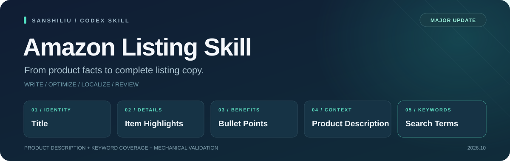

<p align="center">
  
</p>

<h1 align="center">Amazon Listing Skill</h1>

<p align="center">
  <strong>围绕真实产品信息，生成可核对的亚马逊商品文案。</strong>
</p>

<p align="center">
  
  
  
  
</p>

<p align="center">
  <a href="#快速开始">快速开始</a> ·
  <a href="使用说明.md">完整使用说明</a> ·
  <a href="SKILL.md">技能规则</a> ·
  <a href="RELEASE_NOTES.md">大版本更新</a> ·
  <a href="README.en.md">English</a> ·
  <a href="https://sanshiliu.com">三十六的网站</a>
</p>

---

## 本次大版本更新

| 更新重点 | 你能获得什么 |
| --- | --- |
| **新增产品描述** | 完整 Listing 包含 Product Description，也可单独生成、优化和检查 |
| **重整后台关键词规则** | 先整理产品关键词，再筛选、内部去重与核对覆盖情况，说明未采用词的原因 |
| **完善文案校验** | 支持字节预算、可调整限制、严格输入类型、小数规格及 Unicode 处理 |
| **补齐中文使用文档** | 复制产品资料模板即可开始，常用请求和更新方法集中查阅 |

升级前可查看[大版本更新说明](RELEASE_NOTES.md)，了解行为调整和旧 JSON 的兼容方式。

## 一次请求得到什么

| 输出部分 | 主要内容 |
| --- | --- |
| **Title** | 产品身份、类型和关键属性 |
| **Item Highlights** | 补充标题未承载的材质、用途、适配等简短要点 |
| **Bullet Points** | 默认五条，分别说明不同特点、用途及购买关注点 |
| **Product Description** | 用自然段连接功能、场景、材质规格与消费者关注点 |
| **Search Terms** | 一行空格分隔的相关产品搜索关键词 |
| **Review Notes** | 缺失资料、所用预算、关键词覆盖情况和待确认事项 |

也可以只要求其中一项，例如“只生成产品描述”或“只检查 Search Terms”。审核备注与准备上架的正文分开。

## 快速开始

安装后，在 Codex 中发送下面这段请求，或换成你自己的产品资料：

```text
使用 $amazon-listing-skill，生成美国站英文完整 Listing。

产品：红色聚丙烯无盖收纳盒
尺寸：20 × 15 × 10 cm
数量：一件装
用途：家庭办公室的书桌文具收纳
消费者关注：是否带盖、尺寸、材质、包装数量
关键词：storage box, storage bin, desk organizer, desktop organizer,
office organizer, stationery holder, red plastic container, open top box

只使用已确认的事实。没有提供的性能、认证或适配信息不要编造。
缺少关键资料时先问我。
```

可以同时附上产品图片、规格表、包装或已有文案。重要参数建议提供文字；不知道的项目写“未知”或“未提供”。

更多模板见[中文使用说明](使用说明.md)。

### 只写产品描述

```text
使用 $amazon-listing-skill，只生成英文产品描述。
产品事实：（填写已确认的产品资料）
目标站点：（填写）
消费者最关注的问题及已确认答案：（填写）
请用纯文本自然段，不新增没有依据的卖点。
```

描述围绕四个方向自然展开：**功能与特性 → 使用场景 → 材质与规格 → 消费者关注点**。信息不足时会询问或省略，不会将五点简单拼成一段。Product Description 与 A+ 内容是不同交付项。

### 只整理 Search Terms

```text
使用 $amazon-listing-skill，只生成 Search Terms 和简短审核备注。
产品事实：（填写）
目标站点和语言：（填写）
候选关键词及优先级：（粘贴）
请核对关键词覆盖情况，说明未采用关键词的具体原因。
```

**去重只在 Search Terms 内部进行。** 标题、五点、商品要点或产品描述中已有的相关关键词，仍可放进 Search Terms，不因跨字段重复而被删除或降低优先级。

例如 `desk organizer`、`desktop organizer`、`office organizer` 可以整理为：

```text
desk desktop office organizer
```

共享词只出现一次，各条短语中的有效词仍会保留。关键词覆盖不等于已经被 Amazon 索引，也不保证排名。

## 安装与更新

### 安装位置

选择一个位置安装即可。根据 [OpenAI 官方技能文档](https://learn.chatgpt.com/docs/build-skills#where-codex-loads-local-skills)，用户级技能使用 `~/.agents/skills`，项目级技能使用项目中的 `.agents/skills`。

<details>
<summary><strong>Windows PowerShell 安装</strong></summary>

```powershell
New-Item -ItemType Directory -Force -Path "$env:USERPROFILE\.agents\skills" | Out-Null
git clone https://github.com/sanshiliu-studio/amazon-listing-skill.git "$env:USERPROFILE\.agents\skills\amazon-listing-skill"
```

</details>

<details>
<summary><strong>macOS / Linux 安装</strong></summary>

```bash
mkdir -p ~/.agents/skills
git clone https://github.com/sanshiliu-studio/amazon-listing-skill.git ~/.agents/skills/amazon-listing-skill
```

</details>

也可以[下载完整源码 ZIP](https://github.com/sanshiliu-studio/amazon-listing-skill/archive/refs/heads/main.zip)，将包内技能目录命名为 `amazon-listing-skill`，放入所选的技能发现目录。更新没有被识别时，可以重启 Codex。

已有旧路径安装请按实际位置更新，避免同时维护两份名称相同、都会被加载的技能。找不到技能时，也可按[使用说明](使用说明.md)通过完整文件路径指定 `SKILL.md`。

### 更新已有安装

通过 Git 安装的用户，在实际技能目录中处理好自己的改动后执行：

```bash
git pull --ff-only
```

通过 ZIP 安装的用户，先备份自定义规则，再把新版技能文件更新到原目录，保留自己的商品资料和输出。完整升级步骤见[更新说明](RELEASE_NOTES.md#如何更新已有安装)。

## 资料怎么提供

| 信息 | 示例或说明 |
| --- | --- |
| 站点与语言 | 美国站 / 英文；站点和语言分别说明 |
| 产品身份 | 名称、品牌、类目、型号、具体变体 |
| 材质与规格 | 材质、颜色、尺寸、重量、数量及单位 |
| 包装内容 | 实际包含的物品和配件 |
| 卖点与场景 | 已确认的特点、用途及目标人群 |
| 消费者关注点 | 适配、清洁、安装、尺寸等购买问题及已确认答案 |
| 关键词 | 产品词、相关词、优先级及研究数据来源（如有） |
| 证据与参考 | 包装、说明书、检测报告、已有文案或竞品资料 |

竞品资料可帮助理解表达和购买关注点，不能用作自己产品的规格或证明。缺少必要信息时，技能会优先询问一至三个关键问题。

## 校验与审核

日常可以直接说“请运行这个技能的校验，并告诉我仍需确认什么”。卖家无需自己操作脚本。

<details>
<summary><strong>查看默认预算和手动校验方法</strong></summary>

| 字段 | 默认设置 |
| --- | --- |
| 标题 | 75 字符，含空格 |
| Item Highlights | 125 字符，含标点和空格 |
| 五点 | 默认生成五条；校验至少三条，每条 10–255 字符 |
| 产品描述 | 2,000 字符写作预算，含空格和换行 |
| Search Terms | 美国站草稿保守使用最多 249 UTF-8 字节，计入空格 |

上述设置不替代站点与产品类型的当前要求。五条是写作偏好，五点长度需要按产品类型确认。搜索词按字节计算，中文、日文和部分重音字符会占多个字节。

从技能目录运行以下命令；在其他目录运行时使用完整路径。脚本只依赖 Python 标准库。

```bash
python scripts/validate_listing.py listing.json --require-description
python scripts/validate_listing.py description.json --description-only
python scripts/validate_listing.py --help
```

`product_description` 提供时必须是非空字符串。旧 JSON 可以省略它；新完整 Listing 可用 `--require-description` 确认描述存在，独立描述使用 `--description-only`。

预算参数包括 `--title-max-chars`、`--min-bullets`、`--bullet-min-chars`、`--bullet-max-chars`、`--description-max-chars`、`--search-max-bytes`。数值必须是正整数，五点最小长度不能大于最大长度。放宽参数不会自动建立合规性。

描述采用纯文本格式，因此脚本会拒绝 `<br>` 等 HTML 标签；这是本技能的格式选择。完整 JSON 结构见 [SKILL.md](SKILL.md)。

</details>

`PASSED` 表示选定设置下的机械检查通过。来源关键词覆盖、商标、兼容性、受监管声明、单位换算及当前站点规则仍需审核；中文、日文未分词文本的重复概念也需要人工检查。

## 文档导航

| 文档 | 适合什么时候看 |
| --- | --- |
| [中文使用说明](使用说明.md) | 第一次使用、准备资料、复制常用请求模板 |
| [大版本更新说明](RELEASE_NOTES.md) | 从旧版升级、了解兼容性和行为调整 |
| [技能主说明](SKILL.md) | 查看实际执行规则、输入结构和默认输出 |
| [产品描述规则](references/amazon-description-rules.md) | 组织功能、场景、规格与消费者关注点 |
| [Search Terms 规则](references/amazon-search-terms.md) | 整理候选关键词、内部去重和核对覆盖 |
| [审核清单](references/compliance-checklist.md) | 交付前逐项核查 |
| [历史更新记录](<Update Log.md>) | 查看每次修改的详细记录 |
| [English overview](README.en.md) | 英文介绍、安装和使用要点 |

## 适用范围

适用于一般 Amazon 商品文案。沙特阿拉伯、埃及、土耳其、阿拉伯联合酋长国及媒体类目的合规审核，需要相应站点或类目的专用规则。

涉及第三方品牌时，会根据需要检索商标和兼容信息；联网核验属于方向性判断，卖家仍需确认使用依据和实物一致性。技能不会自动把文案发布到 Amazon。

## 开发与维护

```bash
python -B -m unittest discover -s tests -v
```

项目结构：`SKILL.md` 为入口；`references/` 为专项规则；`scripts/` 为校验工具；`tests/` 为回归测试；`assets/` 为项目展示资源。

由 **三十六 / Sanshiliu** 创建与维护 · [sanshiliu.com](https://sanshiliu.com)

项目名称和来源只用于识别技能，不会自动加入生成的商品文案。
